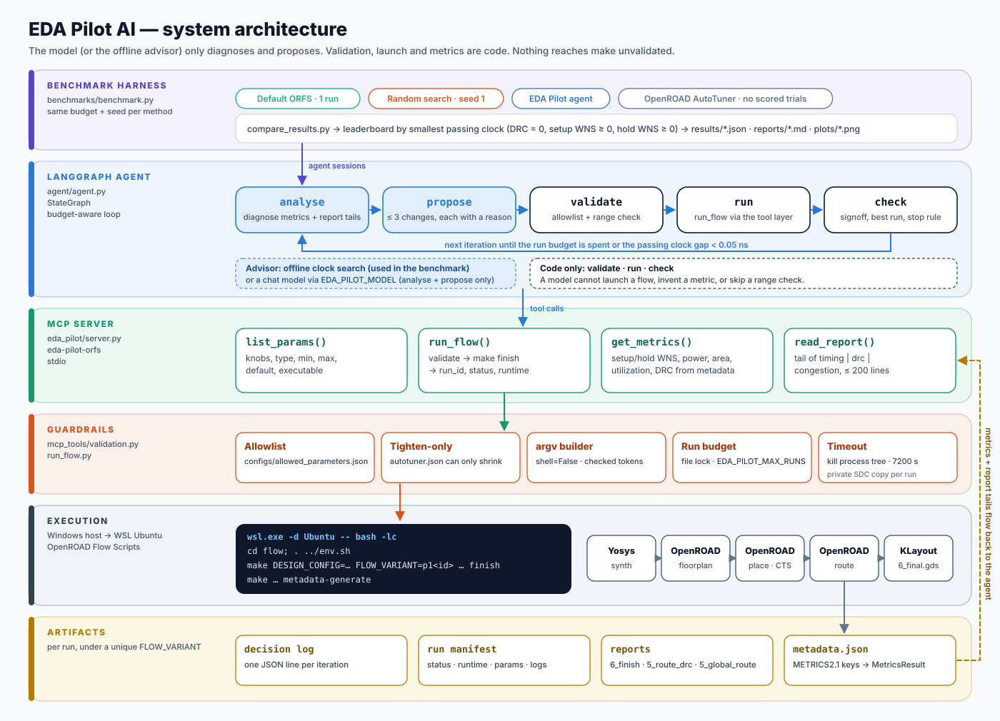
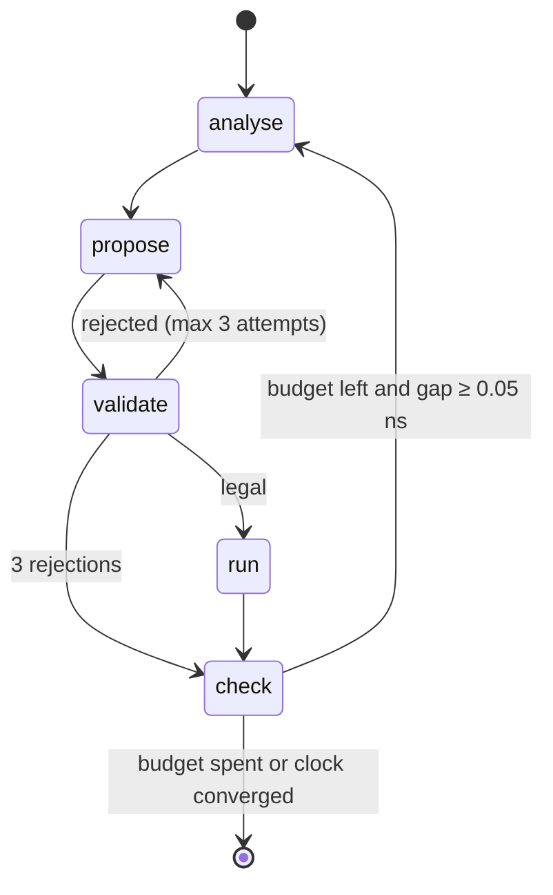

# Architecture

EDA Pilot AI has six layers. Each one only talks to the layer below it through a narrow, typed interface:

```text
Benchmark harness        benchmarks/          default · random · AutoTuner · agent → compare_results
LangGraph agent          agent/               analyse → propose → validate → run → check
MCP server               eda_pilot/server.py  list_params · run_flow · get_metrics · read_report
Guardrails               mcp_tools/           allowlist · typed values · argv builder · budget · timeout
Execution                mcp_tools/run_flow   WSL bridge → make finish → make metadata-generate
EDA flow + artifacts     ORFS                 Yosys → OpenROAD → KLayout → metadata.json, reports, GDS
```

<p align="center"></p>

Diagram sources: [`diagrams/architecture.svg`](diagrams/architecture.svg), [`diagrams/architecture.mmd`](diagrams/architecture.mmd) (Mermaid), [`diagrams/architecture.drawio`](diagrams/architecture.drawio) (diagrams.net), [`diagrams/technology_stack.svg`](diagrams/technology_stack.svg).

---

## 1. Design principles

1. **The model suggests; code decides.** Only the `analyse` and `propose` nodes may call a chat model. Validation, process launch, metric parsing and the stop decision are deterministic Python.
2. **Nothing reaches `make` unvalidated.** Every parameter is checked against the allowlist before a run directory, a manifest or a process exists.
3. **No shell, ever.** The server builds the `make` argv from fixed templates and regex-checked tokens and calls `subprocess.Popen(..., shell=False)`. The WSL bridge passes one bash script assembled only from tokens that already passed those checks.
4. **Design files are read-only.** A clock change is applied through a private copy of `constraint.sdc` under `flow/.eda_pilot/sdc/<run_id>/`. Knobs that would rewrite platform files (`_FR_LAYER_ADJUST`) are listed but marked non-executable.
5. **Missing data stays missing.** Absent metrics are `null` and are named in `missing`. Unavailable methods have no scores. Interrupted attempts are recorded as unscored, never as trials.
6. **Same budget for every method.** The harness gives default, random, AutoTuner and the agent the same run budget, seed and objective.

## 2. Component reference

### 2.1 MCP server: `eda_pilot/server.py`

- Built with the official **MCP Python SDK 2.x**, using `MCPServer`, the renamed FastMCP class, with `@mcp.tool()` registration. Server name `eda-pilot-orfs`, transport stdio. Console script `eda-pilot-orfs`.
- The instructions tell clients to call `list_params` before `run_flow` and to pass only numeric parameters.
- Anticipated failures (`FlowValidationError`, `ConfigurationError`) are re-raised as MCP `ToolError`s with a plain-language message.
- The server is a thin wrapper. Each tool calls one function in `mcp_tools/`. The LangGraph agent imports those same functions and calls them **in process**, so an external MCP client (Inspector, an IDE, another agent) and the built-in agent pass through identical validation, budget and timeout code.

| Tool | Input | Output model | Notes |
| --- | --- | --- | --- |
| `list_params` | `design`, `platform="sky130hd"` | `ParameterList` | Name, type, min, max, default, step, `executable`, `apply`, source |
| `run_flow` | `design`, `platform`, `params: dict[str, float] \| None` | `RunResult` | `run_id`, `status` ∈ {ok, error, timeout}, `runtime`, `flow_variant`, `message` |
| `get_metrics` | `run_id` | `MetricsResult` | setup/hold WNS and TNS, power, area, utilization, DRC count, `missing[]` |
| `read_report` | `run_id`, `report_name` ∈ {timing, drc, congestion} | `ReportResult` | Last ≤ 200 lines, ≤ 512 KB read, lines capped at 2,000 chars |

### 2.2 Guardrails: `mcp_tools/validation.py`

`list_params` and `validate_params` read `configs/allowed_parameters.json`. When ORFS is present they also read the design's `autotuner.json`.

| Check | Rejects |
| --- | --- |
| Name | Unknown design, platform or parameter (`MAKEFLAGS`, path traversal in design names) |
| Executability | Knobs with `apply: unsupported`, such as `_FR_LAYER_ADJUST`, which would rewrite a platform Tcl file |
| Type | Strings (`"40; rm -rf /"`), booleans, non-finite numbers, non-integers for `int` knobs |
| Range and step | Values outside `[minimum, maximum]`, or off the knob's step grid when it has one |
| Duplicates | Repeated keys in a raw JSON parameter string |
| Override policy | A design `autotuner.json` may **tighten** a range. It cannot add a name or widen a range |

Real rejection messages from this code are shown in [`assets/screenshots/mcp_guardrails.png`](assets/screenshots/mcp_guardrails.png), for example `validation error: _SDC_CLK_PERIOD value 9.5 is outside [0.8, 5]`.

**Allowlisted knobs (sky130hd):** `_SDC_CLK_PERIOD`, `CORE_UTILIZATION`, `CORE_ASPECT_RATIO`, `CORE_MARGIN` (gcd only), `CELL_PAD_IN_SITES_GLOBAL_PLACEMENT`, `CELL_PAD_IN_SITES_DETAIL_PLACEMENT`, `PLACE_DENSITY_LB_ADDON`, `CTS_CLUSTER_SIZE`, `CTS_CLUSTER_DIAMETER`. `_FR_LAYER_ADJUST` is listed but non-executable.

| Design | Clock range (ns) | Design default |
| --- | --- | --- |
| `gcd` | 0.8 – 5.0 | 1.1 ns (`constraint.sdc`) |
| `aes` | 3.5 – 7.0 | 3.6 ns |
| `ibex` | 9.0 – 16.0 | SDC sets 8.0 ns, which is below the autotuner sweep, so no override is applied by default |

### 2.3 Flow launch: `mcp_tools/run_flow.py`

`run_flow` performs these steps in order. The first failure stops the call before any process starts.

1. `validate_params(...)`: the checks above.
2. Resolve the flow directory and require `designs/<platform>/<design>/config.mk`.
3. Create `run_id = uuid4().hex` and `FLOW_VARIANT = p1<run_id>`, checked against `^p1[0-9a-f]{32}$`.
4. Build the argv:
   ```text
   make -C <flow> DESIGN_CONFIG=./designs/<platform>/<design>/config.mk FLOW_VARIANT=p1<run_id> [NAME=value ...] [SDC_FILE=.eda_pilot/sdc/<run_id>/constraint.sdc] finish
   ```
   Every token must match its own regular expression. The only allowed target is `finish`.
5. **Windows + WSL path?** If `ORFS_ROOT` is `\\wsl$\<distro>\…` and the launcher is `make`, translate the call to:
   ```text
   wsl.exe -d <distro> -- bash -lc "set -eu; cd '<linux_flow>'; . ../env.sh; make … finish; make … metadata-generate"
   ```
   Each token is single-quoted after it matches `^[A-Za-z0-9_./=+,-]+$`.
6. Reserve one unit of the **run budget** under an exclusive file lock (`runs/.budget.lock`, stale after the timeout plus 30 s).
7. Write the private SDC. It copies `constraint.sdc` and replaces the single `set clk_period <number>` line, and refuses to write if there is not exactly one.
8. Write the manifest (`status: running`), start the process, and wait up to `EDA_PILOT_TIMEOUT_SECONDS`. On timeout it kills the process tree (`killpg` on POSIX, `taskkill /T` on Windows).
9. Save stdout and stderr (the last 5 MB of each) and update the manifest with status, runtime and message.

### 2.4 Metrics and reports: `mcp_tools/metrics.py`, `mcp_tools/reports.py`

`metadata.json` is flattened and looked up by METRICS2.1 aliases:

| Field | Keys tried, in order |
| --- | --- |
| `setup_wns` | `finish__timing__setup__ws`, `finish__timing__setup__wns` |
| `hold_wns` | `finish__timing__hold__ws`, `finish__timing__hold__wns` |
| `power` | `finish__power__total` |
| `area` | `finish__design__instance__area`, `finish__design__core__area` |
| `utilization` | `finish__design__instance__utilization`, `finish__design__core__utilization` |
| `drc_count` | `detailedroute__route__drc_errors`, `finish__drt__drc_count`, `detailedroute__route__drc_count` |

Report names are an enum mapped to known files (`timing` → `6_finish.rpt`, `drc` → `5_route_drc.rpt`, `congestion` → `5_global_route.rpt`, plus fallbacks). The caller never supplies a path, and symlinks are refused.

### 2.5 LangGraph agent: `agent/`



- **State** (`agent/state.py`): design, platform, objective, remaining budget, history, current metrics, best run, clock bounds `[clock_low, clock_high]`, decision log, validation messages and the parameter catalog.
- **Proposal contract** (`agent/proposal_models.py`): `Proposal.changes` holds at most 3 `ParameterChange(parameter, value, reason)` items, with `extra="forbid"` and a reason of at most 500 characters.
- **Signoff** (`signoff_passed`): flow status `ok`, `drc_count == 0`, `setup_wns ≥ 0`, `hold_wns ≥ 0`. Any missing metric means fail.
- **Best run** (`is_better_run`): any pass beats any fail. Among passes the smaller clock wins. Among fails, fewer DRCs and then less negative slack wins.
- **Advisors.** `analyse` and `propose` call a *diagnoser* and a *proposer*:
  - **Offline** (default, and what the benchmark used). The diagnoser describes only the metrics in state. The proposer starts at the design default clock, clamped into range, then bisects the clock bounds. A pass lowers `clock_high` and a timing miss raises `clock_low`. If the midpoint repeats the last value, it steps by at least 0.05 ns. When DRC > 0 it also lowers `CORE_UTILIZATION` by 4. That never triggered in this study.
  - **Chat model** (`EDA_PILOT_MODEL`, for example `openai:gpt-4.1-mini`). It uses LangChain `init_chat_model` with structured output into `Diagnosis` and `Proposal`, and a system prompt that forbids running commands, inventing metrics or proposing `_FR_LAYER_ADJUST`.
- **Stop rules:** the budget is exhausted, or a passing run exists and `clock_high − clock_low < 0.05 ns`.
- **Decision log:** one JSON line per iteration, with advisor, diagnosis, proposal, parameters, flow status, metrics, result and duration.

### 2.6 Benchmark harness: `benchmarks/`

| Module | Method |
| --- | --- |
| `benchmark.py` | `run_matrix` over designs × budgets × methods. It writes one record per method and a comparison |
| `run_default` | One unmodified ORFS run, shared across budgets |
| `run_random.py` | `random.Random(seed)`. It samples every executable knob uniformly (integers inclusive) and redraws up to 20 times until a sample validates |
| `run_autotuner.py` | `openroad_autotuner --design … --platform … --config … --jobs 1 tune --samples <budget> --iterations 1 --seed <seed> --algorithm hyperopt`. A missing executable is recorded as `unavailable` and a crash as `error` |
| `run_agent.py` | `agent.run_session` with its own decision log |
| `compare_results.py` | Ranking key for passes: (clock, area, power, runtime). For fails: (setup WNS, DRC, hold WNS) |

## 3. Data flow of one agent iteration

```text
check(prev) ─▶ analyse: read get_metrics + read_report(timing) tails
            ─▶ propose: {"changes":[{"parameter":"_SDC_CLK_PERIOD","value":2.867,"reason":"Reduce … because the last run met DRC, setup, and hold."}]}
            ─▶ validate: validate_params → ok | message (retry ≤ 3)
            ─▶ run: run_flow → run_id, status, runtime  (budget −1)
            ─▶ check: get_metrics → signoff? best run? bounds → stop?
```

## 4. Configuration

| Variable | Default | Effect |
| --- | --- | --- |
| `ORFS_ROOT` / `ORFS_FLOW_DIR` | unset / `$ORFS_ROOT/flow` | Where `flow/Makefile` lives |
| `ORFS_MAKE` | `make` | Launcher. A `.py` path runs under the current interpreter (used by the tests) |
| `EDA_PILOT_TIMEOUT_SECONDS` | 7200 | Per-run wall-clock limit |
| `EDA_PILOT_MAX_RUNS` | 8 | Server-wide run budget. The agent refuses to start if its budget is larger |
| `EDA_PILOT_RUNS_DIR` | `runs` | Manifests, logs, decision log |
| `EDA_PILOT_ALLOWED_PARAMETERS` | `configs/allowed_parameters.json` | Allowlist |
| `EDA_PILOT_MODEL` | unset | Chat model for `analyse` and `propose`. Unset means the offline advisor |
| `ORFS_AUTOTUNER` | unset | AutoTuner executable for the harness |

## 5. Security model

| Threat | Mitigation |
| --- | --- |
| Model or client injects shell commands | No shell. Numeric-only values. Regex-checked argv tokens. Bash tokens single-quoted after an allowlist match |
| Model chooses an unsafe knob | Allowlist names only. Unsupported knobs are non-executable. Design overrides are tighten-only |
| Path traversal via design or report name | Design and platform names match `^[a-z][a-z0-9_]*$`. Reports are an enum. Symlinks are refused |
| Runaway cost | File-locked run budget, per-run timeout, process-tree kill |
| Invented results | Metrics come only from `metadata.json`. Missing values are `null`. Unavailable methods are never filled in |
| Design corruption | Private SDC copy per run. The design `constraint.sdc` and platform files are never written |

## 6. Testing

48 pytest tests (`tests/`) run against `tests/fake_make.py`, a stand-in that records its argv and writes canned metadata. They cover:

- every rejection path, including unknown names, strings, booleans, duplicate keys, out-of-range values, non-executable knobs, path traversal, and tighten-only overrides
- that `run_flow` never uses a shell, uses a unique variant, rewrites only the private SDC, enforces the timeout and the budget, and sends `make` to WSL only for `\\wsl$` paths
- `read_report` returning tails and refusing filenames
- an in-process MCP client session against the real server, and that the four tools are registered
- agent behaviour: a 10-run session stops at the budget, illegal proposals never run, the best run is a passing run, and the agent budget cannot exceed the server limit
- harness behaviour: random search stays in range and repeats a seed, default is one unmodified run, AutoTuner uses the shared budget and records no metrics when missing, and the comparison ranks the smaller passing clock

## 7. Key design decisions

| Decision | Why | Trade-off |
| --- | --- | --- |
| One tool layer, exposed over MCP | One audited choke point. The built-in agent calls the `mcp_tools` functions in process, and any MCP client, including Inspector, reaches the same functions over stdio | The benchmarked agent did not exercise the MCP transport itself. The server is covered by its own in-process client test |
| Clock via private SDC copy | Clock is the primary knob, and ORFS reads it from the SDC. Copying keeps design files untouched | Requires exactly one `set clk_period` line |
| Offline advisor as default | Reproducible, free and explainable. It establishes the baseline the LLM must beat | Searches one dimension (clock) |
| WSL bridge instead of a Windows Make port | ORFS and OpenROAD are supported on Linux. The bridge reuses the validated argv unchanged | Windows-only code path, tested by argv translation |
| Signoff-first ranking | A failing fast clock is not a result | Area and power are secondary keys only |
