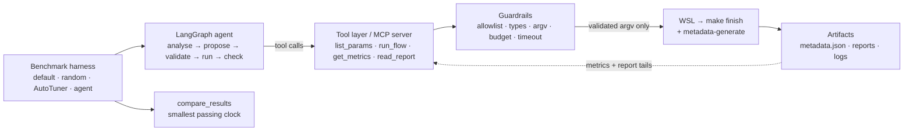
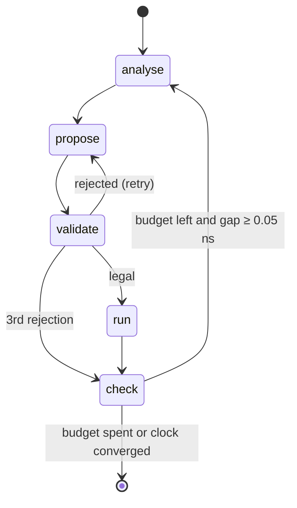

# Case study: a guarded agent for OpenROAD timing closure

**EDA Pilot AI** · v1.0.0 · SkyWater SKY130 HD · `gcd`, `aes`, `ibex` · budget 10 · seed 1

> **Abstract.** A physical-design run is slow, and its parameters interact. An agent that may type shell commands or edit platform files is unsafe to point at a real flow. EDA Pilot AI splits the work. A LangGraph loop diagnoses and proposes. A typed tool layer, published as an MCP server, validates every proposal against an allowlist before GNU Make starts. The loop was benchmarked against default OpenROAD Flow Scripts and seeded random search under the same 10-run budget, using a deterministic offline advisor that bisects the clock. It signed off all three designs, where default ORFS signed off none. Its passing clocks were 30.3%, 23.0% and 14.5% tighter than random search's. Random search kept the better area, power and runtime at its looser clocks. The study is a single seed on one PDK, and no chat model made decisions in it.

## Contents

1. [Problem statement](#1-problem-statement)
2. [Research motivation](#2-research-motivation)
3. [System design](#3-system-design)
4. [Agent architecture](#4-agent-architecture)
5. [MCP design](#5-mcp-design)
6. [Benchmark methodology](#6-benchmark-methodology)
7. [Experimental setup](#7-experimental-setup)
8. [Results analysis](#8-results-analysis)
9. [Lessons learned](#9-lessons-learned)
10. [Future research](#10-future-research)

---

## 1. Problem statement

**Find the smallest clock period at which an RTL design completes the open-source flow with DRC = 0, setup WNS ≥ 0 and hold WNS ≥ 0. Use at most 10 flow runs, and never execute a parameter outside a published range.**

Three facts make this hard:

1. **Every evaluation is expensive.** On this setup a single `make finish` took about a minute for `gcd` and up to almost two hours for `ibex` at a tight clock. The 52 scored runs in the study add up to about 21.2 hours of flow wall-clock.
2. **The default target is not a valid answer.** The ORFS default clocks for all three designs *fail* setup on sky130hd: −1.460 ns at 1.1 ns (`gcd`), −0.081 ns at 3.6 ns (`aes`) and −0.551 ns at the 8.0 ns `ibex` SDC. DRC is 0 in all three, so the flow "finishes" and still produces a chip that does not meet its constraint.
3. **The response surface is noisy.** Placement and routing change with the constraint, so slack is not perfectly monotonic in clock period. In this study `aes` passed at 4.822 ns and failed at 4.832 ns by −0.0056 ns.

A fourth constraint is about safety rather than search. An autonomous agent driving `make` can, if unconstrained, pass arbitrary variables, rewrite `config.mk` or platform Tcl, run shell commands, or burn hours of compute. The system must make those actions **impossible**, not merely discouraged by a prompt.

## 2. Research motivation

**Why agents for EDA.** Design-space exploration in physical design is traditionally done by hand, by scripted sweeps, or by black-box tuners such as OpenROAD AutoTuner, which uses Ray Tune with search algorithms like HyperOpt. These tools treat the flow as a function from parameters to a score. An engineer does something different: reads the timing report, notices *why* a run failed, and changes the one knob that matters. Language-model agents promise that kind of diagnosis-driven search, but they bring a new risk. A model that can call tools can call them badly.

**The research questions.**

| # | Question | How the study answers it |
| --- | --- | --- |
| RQ1 | Can an agent loop be made **safe by construction** against a real OpenROAD flow? | The allowlist, typed values, a fixed argv with `shell=False`, the budget lock and timeouts are enforced in code, covered by 48 tests and exercised by 52 real runs |
| RQ2 | Under an equal budget, does a **signoff-first** loop beat default ORFS and random search on the smallest passing clock? | Yes on all three designs (single seed) |
| RQ3 | What does the tighter clock **cost**? | Area +7.5% to +23.3%, power +29.7% to +70.8%, runtime 1.47× to 5.53× compared with random search's best pass |
| RQ4 | Does the loop **fail differently** from random search? | Yes. Random search fails on feasibility (density, placement, congestion). The agent fails on timing near the boundary, plus two timeouts |

**What this project deliberately does not claim.** It does not claim that an LLM out-searches a classical optimizer. The benchmarked advisor is a deterministic bisection, so RQ2 measures the *loop and its policy*, not model intelligence. That policy is the baseline a chat-model advisor would have to beat next.

## 3. System design

The design follows five rules (full detail in [ARCHITECTURE.md](ARCHITECTURE.md)):

1. **The model suggests and code decides.** Only `analyse` and `propose` may call a model. Validation, launch, metric parsing and the stop decision are deterministic Python.
2. **Nothing reaches `make` unvalidated.** Names, types, ranges and step grid are checked before a run directory, manifest or process exists.
3. **No shell.** The argv is assembled from fixed templates and regex-checked tokens and launched with `shell=False`. The WSL bridge wraps that same validated argv in one `bash -lc` script.
4. **Design files are read-only.** A clock change goes into a private copy of `constraint.sdc` per run. Knobs that would rewrite platform files (`_FR_LAYER_ADJUST`) are listed but non-executable.
5. **Missing data stays missing.** Absent metrics are `null`. Unavailable methods have no scores. Interrupted attempts are recorded as unscored.

**Parameter space.** Ranges come from each design's ORFS `autotuner.json` and are bounded by `configs/allowed_parameters.json`. A design file can only *tighten* a range, never widen it.

| Knob | `gcd` range | Applied through |
| --- | --- | --- |
| `_SDC_CLK_PERIOD` | 0.8 – 5.0 ns (default 1.1) | private SDC copy |
| `CORE_UTILIZATION` | 20 – 50 % | make variable |
| `CORE_ASPECT_RATIO` | 0.5 – 2.0 | make variable |
| `CORE_MARGIN` | 1 – 3 | make variable |
| `CELL_PAD_IN_SITES_GLOBAL_PLACEMENT` / `…_DETAIL_PLACEMENT` | 0 – 3 | make variable |
| `PLACE_DENSITY_LB_ADDON` | 0.0 – 0.2 | make variable |
| `CTS_CLUSTER_SIZE` / `CTS_CLUSTER_DIAMETER` | 10 – 200 / 20 – 400 | make variable |
| `_FR_LAYER_ADJUST` | 0.1 – 0.3 | **not executable** (would rewrite platform Tcl) |

Clock ranges for the other designs are `aes` 3.5–7.0 ns (default 3.6) and `ibex` 9.0–16.0 ns. The `ibex` SDC's own 8.0 ns lies below that sweep.

## 4. Agent architecture

The agent is a LangGraph `StateGraph` with five nodes.

| Node | Kind | Responsibility |
| --- | --- | --- |
| `analyse` | advisor | Turn the latest metrics and capped report tails into a short diagnosis |
| `propose` | advisor | Return a `Proposal`: at most 3 `ParameterChange(parameter, value, reason)` items, `extra="forbid"` |
| `validate` | code | Allowlist, type, range and step checks. Up to 3 attempts, after which the iteration is logged as rejected |
| `run` | code | `run_flow` → `run_id`, status, runtime. Decrements the budget |
| `check` | code | Signoff test, best-run update, clock-bound update, stop rule, decision-log line |

**State** holds the design, platform, objective, remaining budget, history, current metrics, best run, clock bounds `[clock_low, clock_high]`, the parameter catalog and validation messages.

**Advisors.** `analyse` and `propose` delegate to a *diagnoser* and a *proposer*, chosen at start-up:

- **Offline advisor**, which is the default and what the benchmark used. The first proposal is the design default clock, clamped into range (`ibex`, whose SDC value lies outside the sweep, starts at the 9.0 ns floor). After that, a pass lowers `clock_high` and a timing miss raises `clock_low`, and the next clock is the midpoint. If the midpoint repeats the last value, it steps by at least 0.05 ns. A timeout leaves the bounds unchanged. If DRC > 0, the proposer also lowers `CORE_UTILIZATION` by 4. That rule never fired, because every finished run in the study had DRC = 0.
- **Chat-model advisor** (`EDA_PILOT_MODEL`). LangChain `init_chat_model` with structured output into `Diagnosis` and `Proposal`. The system prompt forbids running commands, inventing metrics and proposing `_FR_LAYER_ADJUST`. A rejected proposal is returned to the model with the validation message. This path is unit-tested with injected advisors but was not part of the measured study.

**Stop rule.** Stop when the budget is spent, or when a passing run exists and `clock_high − clock_low < 0.05 ns`.

**A real session** (`gcd`, from the decision log):

| Iter | Clock (ns) | Result | Setup WNS (ns) | Bounds after |
| ---: | ---: | --- | ---: | --- |
| 1 | 1.100 | miss | −1.460 | [1.1, 5.0] |
| 2 | 3.050 | **pass** | +0.029 | [1.1, 3.05] |
| 3 | 2.075 | miss | −0.433 | [2.075, 3.05] |
| 4 | 2.562 | miss | −0.050 | [2.562, 3.05] |
| 5 | 2.806 | miss | −0.013 | [2.806, 3.05] |
| 6 | 2.928 | **pass** | +0.061 | [2.806, 2.928] |
| 7 | **2.867** | **pass** | +0.000085 | [2.806, 2.867] |
| 8 | 2.837 | miss | −0.059 | [2.837, 2.867] → gap 0.03 ns, converged |

## 5. MCP design

**Server.** `eda-pilot-orfs`, built on the official MCP Python SDK 2.x (`MCPServer`, the renamed FastMCP class), served over stdio. Its instructions tell clients to call `list_params` before `run_flow` and to pass only numbers.

| Tool | Contract | Guard |
| --- | --- | --- |
| `list_params(design, platform="sky130hd")` | Knobs with type, min, max, default, step, `executable` | `design` must match `^[a-z][a-z0-9_]*$` and be in the catalog |
| `run_flow(design, platform, params)` | `run_id`, status ∈ {ok, error, timeout}, runtime, flow variant, message | Numeric values only (booleans, strings and non-finite values are rejected), in range, on the step grid. Budget lock, timeout with a process-tree kill, unique `FLOW_VARIANT` |
| `get_metrics(run_id)` | Setup/hold WNS and TNS, power, area, utilization, DRC, `missing[]` | Reads only that run's `metadata.json` (METRICS2.1 aliases) |
| `read_report(run_id, report_name)` | Tail of `timing`, `drc` or `congestion` | Enum names, not paths. ≤ 200 lines, ≤ 512 KB read, ≤ 2,000 characters per line |

**Why MCP.** The tool layer is the single place where a proposal turns into a process. Publishing it over MCP means any client, whether MCP Inspector, an IDE assistant or another agent, gets exactly the guarantees the built-in agent gets. The built-in agent imports the same `mcp_tools` functions and calls them in process. The MCP transport adds no extra trust, and bypassing it gains nothing.

**Failure surface.** Anticipated failures (`FlowValidationError`, `ConfigurationError`) become MCP `ToolError`s with a plain message such as `validation error: _SDC_CLK_PERIOD 9.5 is above maximum 5.0`. A rejected call never creates a run directory, consumes budget or starts a process.

## 6. Benchmark methodology

**Objective and ranking.** Passing runs are ranked by (clock, area, power, runtime) and failing runs by (setup WNS, DRC, hold WNS). Any pass beats any fail. Area and power are reported, but they cannot override a tighter passing clock.

**Methods under the same budget and seed:**

| Method | Definition |
| --- | --- |
| Default ORFS | One run with no overrides |
| Random search | `random.Random(1)`, every executable knob sampled uniformly. Redrawn (≤ 20 times) until the sample validates |
| OpenROAD AutoTuner | `tune --samples 10 --iterations 1 --seed 1 --algorithm hyperopt`. A missing executable is recorded as `unavailable` and a crash as `error`, with no metrics |
| EDA Pilot agent | The LangGraph loop with the offline advisor. It may stop early on convergence |

**Fairness controls.** All methods share the allowlist, the flow, the toolchain and the timeout. Random search had a *larger* action space (all knobs) than the agent (clock only), which favours random on feasibility-related metrics.

**Bookkeeping rules.**

- Runtime is the flow-process wall-clock measured by `run_flow`.
- A run whose parent process died, with its manifest still saying `running`, is an **unscored interruption**. The same sample or clock search continues in a new flow variant. Six such attempts are listed separately.
- Unavailable or crashed methods keep empty scores.

## 7. Experimental setup

| Item | Value |
| --- | --- |
| PDK / platform | SkyWater SKY130, `sky130hd` |
| Designs | `gcd` (small arithmetic block), `aes` (AES cipher core), `ibex` (Ibex RISC-V core) |
| Toolchain | Yosys 0.68+, OpenROAD `26Q4-110-g91e5f5ff2f`, KLayout 0.30.0, GNU Make 4.4.1 |
| Host | Windows with WSL Ubuntu 26.04 LTS. ORFS runs inside WSL through the `run_flow` bridge |
| Software | Python 3.11 host environment, LangGraph, MCP Python SDK 2.x, Pydantic v2. AutoTuner attempted in a separate Python 3.12 / Ray environment |
| Budget / seed / timeout | 10 / 1 / 7,200 s per flow |
| Campaign | `gcd` in one pass. `aes` and `ibex` through a checkpointed, resumable campaign (`scripts/resume_campaign.py`) |
| Record | `results/final_benchmark_results.json`: 52 scored runs, 12 method summaries, 6 unscored interruptions |

## 8. Results analysis

### 8.1 Primary objective

| Design | Default | Random best pass | **Agent best pass** | Δ vs random |
| --- | --- | ---: | ---: | ---: |
| `gcd` | ❌ −1.460 ns WNS | 4.113 ns | **2.867 ns** | −30.3% |
| `aes` | ❌ −0.081 ns WNS | 6.261 ns | **4.822 ns** | −23.0% |
| `ibex` | ❌ −0.551 ns WNS | 10.531 ns | **9.000 ns** | −14.5% |

**Reading it correctly.** The gain over default is *a legal signoff*, not a faster clock, because the agent's passing clocks are slower than the failing default targets. The gain over random search is a genuinely tighter passing clock. Of the three, `ibex` is the weakest evidence: one run at the floor of the allowed range, which means the true limit may be lower than the allowlist permits.

### 8.2 Signoff rate

| | `gcd` | `aes` | `ibex` | Pooled |
| --- | ---: | ---: | ---: | ---: |
| Default | 0/1 | 0/1 | 0/1 | 0/3 |
| Random | 4/10 | 1/10 | 6/10 | 11/30 (36.7%) |
| Agent | 3/8 | 3/10 | 1/1 | 7/19 (36.8%) |

The pooled rates are essentially equal. The clearest rate gain is `aes`, at 3/10 against 1/10, where random search spent most of its budget on infeasible floorplans.

### 8.3 What the tighter clock costs

| Design | Area | Power | Runtime |
| --- | ---: | ---: | ---: |
| `gcd` | +23.3% | +70.8% | 1.47× |
| `aes` | +9.2% | +38.4% | 1.65× |
| `ibex` | +7.5% | +29.7% | 5.53× |

This is expected physics. A tighter clock makes repair and resizing add larger, faster cells and buffers, so area and switching power go up, and detailed routing works harder. Against the failing defaults, the agent's best points still use 6–23% less area and 14–73% less power, because the defaults were pushing even harder clocks.

<table>
  <tr>
    <td></td>
    <td></td>
  </tr>
  <tr>
    <td></td>
    <td></td>
  </tr>
</table>

### 8.4 How the searches behaved

- **The agent converges.** On `gcd` the bisection closed to a 0.03 ns bracket in 8 runs. On `aes` it spent its budget with the bracket at [4.742, 4.822] ns. Two timeouts, at 4.768 and 4.782 ns, cost two runs and left the bounds unchanged. The final proposal, 4.832 ns, lay *above* the best pass. After the second timeout the midpoint repeated the last clock, so the minimum-step rule stepped up by 0.05 ns, and that step is clamped to the allowed range, not to the bracket. The decision log exposed this policy gap, and it cost the last run.
- **Random search explores.** Its samples cover the whole range, so its best pass is wherever luck put a feasible point. Many of its draws combined high utilization with density add-ons that placement could not legalize.
- **Non-monotonicity is real.** `aes` at 4.832 ns failed while 4.822 ns passed. A bisection assumes a monotone boundary, and near the boundary that assumption only approximately holds.

### 8.5 Failure modes

| Class | Random | Agent |
| --- | ---: | ---: |
| Placement density > 1.0 (FLW-0024) | 5 | 0 |
| Detailed placement check (DPL-0033) | 5 | 0 |
| Global routing congestion (GRT-0116) | 2 | 0 |
| Other ORFS error | 1 | 0 |
| Timing miss (finished, DRC 0) | 5 | 10 |
| Flow timeout (7,200 s) | 0 | 2 |

Random search fails on **feasibility** and the agent fails on **timing near the boundary**. These are complementary failure profiles, which is the strongest argument for a hybrid policy (see §10). `aes` random 3 is a scored flow error with no class of its own, because its only attempt was interrupted. It is the 14th random flow error and is not counted in the table.

### 8.6 AutoTuner

AutoTuner produced **no scored trials**. The executable was missing during the `gcd` and `aes` campaigns. On `ibex` it launched, but Ray could not import HyperOpt before the first sample. The row is kept empty on purpose.

## 9. Lessons learned

The full list is in [docs/lessons_learned.md](docs/lessons_learned.md). The ones that changed the design:

1. **Define success before you search.** Ranking by clock alone would have rewarded the failing defaults. Signoff has to be the gate.
2. **Put the model on the suggestion path, never the launch path.** Every illegal proposal in testing died in `validate`, and no process started.
3. **Windows cannot see GNU Make.** The first real run failed with `FileNotFoundError`. A narrow WSL bridge reused the validated argv, and `metadata-generate` had to follow `finish`, because `finish` alone writes no `metadata.json`.
4. **A `running` manifest is not a live run.** Liveness needs the process list and log timestamps. Dead attempts are recorded as unscored instead of being replayed.
5. **Checkpoint after every scored trial**, including the agent's clock bounds after every iteration, not only at the end of a session.
6. **Early stop is a sample-size statement.** `ibex` at 1/1 is one observation, so publish the denominator.
7. **Tool installation is part of the method.** An unmeasured method has to stay empty.
8. **Store the error line, not the exit code.** "Exited with status 2" told us nothing. The log line told us FLW-0024.
9. **Clamp search steps to what you know.** The `aes` session's last run re-tested a clock above an existing pass, because the minimum step after a timeout respected the range but not the bracket. Decision logs make this kind of policy gap visible.

## 10. Future research

Ordered by what the current evidence most needs. The full plan is in [docs/roadmap.md](docs/roadmap.md).

1. **Make AutoTuner real.** Repair the Ray/HyperOpt environment and run the same budget and seed on all three designs, so the comparison includes a mature black-box optimizer.
2. **Multiple seeds.** Report the distribution of best passing clocks for random search and the agent, and test whether the 14.5–30.3% gains hold.
3. **Benchmark the chat-model advisor** against the offline bisection, with the same budget. Does diagnosis from report tails (for example, choosing utilization when congestion appears) beat a one-dimensional clock search?
4. **Hybrid policy.** Bisect the clock, and spend leftover budget on area and power knobs at the found clock. Random search's feasibility failures and the agent's timing failures suggest the two are complementary.
5. **Widen the `ibex` range.** The agent stopped at the allowlist floor. A lower floor, set from the design rather than the autotuner sweep, would show where the real limit is.
6. **Multi-objective reporting.** Publish a second ranking by area and power among signoff points, alongside the clock-first ranking.
7. **More platforms and designs**, one at a time, such as `nangate45` and a larger sky130hd block, each through the same tighten-only allowlist.
8. **Cost-aware budgets.** Count wall-clock hours, not runs, since one `ibex` run can cost as much as a hundred `gcd` runs.

Explicitly out of scope until the measurements above exist: DRC prediction, reinforcement learning and GNN-based slack prediction.

---

*All figures come from [`results/final_benchmark_results.json`](results/final_benchmark_results.json). See [BENCHMARK_RESULTS.md](BENCHMARK_RESULTS.md) for every trial. Cite this work using [`citations.bib`](citations.bib).*
