<p align="center">
  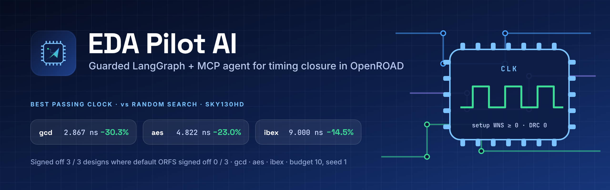
</p>

<p align="center">
  <a href="#benchmark-results"></a>
  <a href="BENCHMARK_RESULTS.md"></a>
  
  
  
  
  
  <a href="LICENSE"></a>
</p>

<p align="center">
  <a href="#-results-at-a-glance">Results</a> ·
  <a href="#-features">Features</a> ·
  <a href="#-architecture">Architecture</a> ·
  <a href="#-installation">Install</a> ·
  <a href="#-usage">Usage</a> ·
  <a href="#benchmark-results">Benchmarks</a> ·
  <a href="CASE_STUDY.md">Case study</a> ·
  <a href="docs/roadmap.md">Roadmap</a>
</p>

---

**EDA Pilot AI** is a closed-loop optimizer for semiconductor physical design. A **LangGraph** agent searches OpenROAD Flow Scripts (ORFS) settings for the **smallest clock period that still signs off**, while a guarded tool layer, published as an **MCP server**, stands between the agent and the flow and refuses anything that is not on an allowlist. Every change is validated in code before GNU Make starts. The flow then runs Yosys, OpenROAD and KLayout (through WSL on Windows), and the metrics come back from the flow's own `metadata.json`.

The project is **complete**. It was measured on three SkyWater SKY130 HD designs (`gcd`, `aes`, `ibex`) against default ORFS and seeded random search, with a 10-run budget per method.

> **Signoff** in this project means the flow finished, DRC count = 0, setup WNS ≥ 0 and hold WNS ≥ 0. A faster clock that misses setup counts as a failed run, not a win.

## ✨ Results at a glance

| Design | Default ORFS | Random search (best pass) | **EDA Pilot agent (best pass)** | Tighter than random |
| --- | --- | ---: | ---: | ---: |
| `gcd` | 1.1 ns · **fails setup** (WNS −1.460 ns) | 4.113 ns | **2.867 ns** | **30.3%** |
| `aes` | 3.6 ns · **fails setup** (WNS −0.081 ns) | 6.261 ns | **4.822 ns** | **23.0%** |
| `ibex` | 8.0 ns SDC · **fails setup** (WNS −0.551 ns) | 10.531 ns | **9.000 ns** | **14.5%** |

- ✅ **The agent signed off 3 of 3 designs. Default ORFS signed off 0 of 3.**
- ⏱️ **Tightest passing clock on every design**, 14.5–30.3% below the best random-search result.
- ⚖️ **The trade-off is stated up front.** The tighter clocks cost **7–23% more area**, **30–71% more power** and **1.5–5.5× the runtime** of random search's looser passing points. Pooled signoff rates are about equal (agent 7/19, random 11/30).
- 🧪 **52 scored ORFS runs** (~21 hours of flow wall-clock) and **48 unit tests** that run without OpenROAD.

<p align="center">
  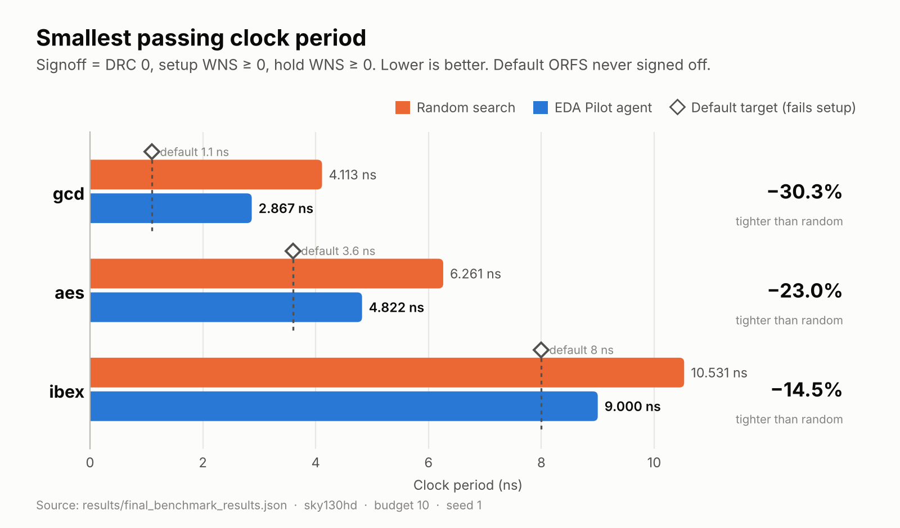
</p>

## 🧭 Why this exists

Closing timing in a physical-design flow is a search problem. Each attempt is a full place-and-route run that takes minutes to hours, and the knobs interact. Language-model agents are a natural fit for proposing the next experiment, but an agent that can type arbitrary `make` arguments, edit platform Tcl, or invent a metric is a liability.

EDA Pilot answers one question honestly: **can a guarded agent loop find a smaller signoff clock than the default flow and random search, under the same run budget, while never letting the model touch the launch path?**

## 🚀 Features

| | Feature | What it does |
| --- | --- | --- |
| 🧠 | **LangGraph agent** | Five-node loop `analyse → propose → validate → run → check`. Only `analyse` and `propose` may use a model; the other three are code. Each proposal has at most three changes, and every change needs a parameter, a value and a reason. |
| 🔌 | **MCP server** | `eda-pilot-orfs` over stdio (MCP Python SDK 2.x) with four tools: `list_params`, `run_flow`, `get_metrics`, `read_report`. It works with MCP Inspector or any MCP client. |
| 🛡️ | **Guardrails before launch** | An allowlist (`configs/allowed_parameters.json`) that a design's `autotuner.json` may only tighten. It rejects unknown names, strings, booleans, duplicate keys and out-of-range values. The server builds the `argv` itself with `shell=False`, takes a file-locked run budget, and kills the process tree on timeout. |
| 🧱 | **OpenROAD integration** | Runs ORFS `make … finish` under a unique `FLOW_VARIANT`. Each run gets its own SDC copy for the clock, so design files are never edited. A narrow **WSL bridge** sources `env.sh` and runs `metadata-generate`. |
| 📏 | **Metrics extraction** | Maps METRICS2.1 keys to setup/hold WNS and TNS, power, area, utilization and DRC count. Missing values come back as `null` and are never guessed. |
| 📊 | **Benchmark harness** | Runs default ORFS, seeded random search, OpenROAD AutoTuner and the agent under one budget. It ranks methods by smallest passing clock and reports area, power and runtime alongside. |
| 📝 | **Reporting** | Checkpointed campaign results, a per-iteration decision log, a failure taxonomy (FLW-0024, DPL-0033, GRT-0116, timeouts), and publication plots. |

## 🏗️ Architecture

<p align="center">
  
</p>

Sources: [`diagrams/architecture.svg`](diagrams/architecture.svg) · [`architecture.mmd`](diagrams/architecture.mmd) · [`architecture.drawio`](diagrams/architecture.drawio) · full write-up in [ARCHITECTURE.md](ARCHITECTURE.md).

### Workflow: one agent iteration

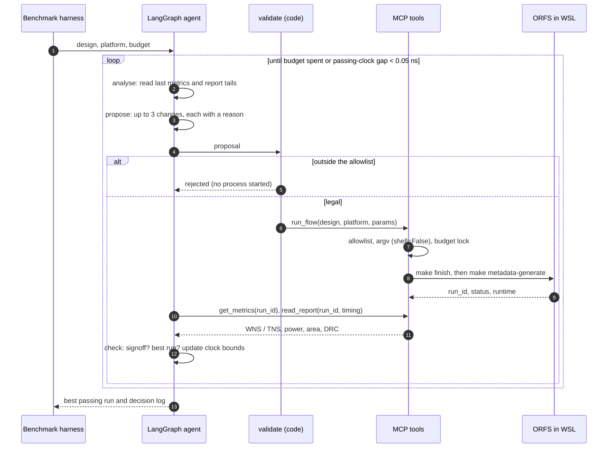

## 📦 Installation

**Requirements**

- Python **3.11+**
- An [OpenROAD-flow-scripts](https://github.com/The-OpenROAD-Project/OpenROAD-flow-scripts) checkout, built with OpenROAD and Yosys. This is only needed for real runs.
- GNU Make. On Windows, ORFS runs inside **WSL Ubuntu**, and the server reaches it through the `\\wsl$\<distro>\…` path.

```bash
git clone https://github.com/NileshModlier/EDA-Pilot-AI.git
cd EDA-Pilot-AI
python -m pip install -e ".[dev]"     # mcp>=2, pydantic>=2, langgraph>=1, pytest
python -m pytest                      # 48 tests, no OpenROAD needed
```

**Point the server at the flow**

```bash
export ORFS_ROOT=/path/to/OpenROAD-flow-scripts         # Windows: $env:ORFS_ROOT = "\\wsl$\Ubuntu\home\<user>\OpenROAD-flow-scripts"
export EDA_PILOT_TIMEOUT_SECONDS=7200                     # per finish run
export EDA_PILOT_MAX_RUNS=10                              # must be >= the agent budget
```

| Variable | Default | Meaning |
| --- | --- | --- |
| `ORFS_ROOT` | unset | Checkout that contains `flow/Makefile` |
| `ORFS_FLOW_DIR` | `$ORFS_ROOT/flow` | Override for the Makefile directory |
| `ORFS_MAKE` | `make` | Make executable (a `.py` stand-in runs under the current interpreter, still `shell=False`) |
| `EDA_PILOT_TIMEOUT_SECONDS` | `7200` | Wall-clock limit for one finish run; the process tree is killed when it expires |
| `EDA_PILOT_MAX_RUNS` | `8` | Finish runs this server process may start |
| `EDA_PILOT_RUNS_DIR` | `runs` | Manifests, stdout and stderr per run |
| `EDA_PILOT_ALLOWED_PARAMETERS` | `configs/allowed_parameters.json` | Parameter allowlist |
| `EDA_PILOT_MODEL` | unset | Unset = offline clock search. Set a chat model (e.g. `openai:gpt-4.1-mini`) for `analyse` / `propose` only |
| `ORFS_AUTOTUNER` | unset | Optional `openroad_autotuner` executable for the benchmark |

## 🛠️ Usage

**1. Serve the tools over MCP** (stdio)

```bash
python -m eda_pilot.server                 # or the console script: eda-pilot-orfs
mcp dev eda_pilot/server.py                # MCP Inspector (pip install "mcp[cli]")
```

| Tool | Returns |
| --- | --- |
| `list_params(design, platform="sky130hd")` | Tunable knobs with type, minimum, maximum, default, step, `executable` |
| `run_flow(design, platform, params)` | Validates, starts `finish`, returns `run_id`, `status` (`ok` / `error` / `timeout`), `runtime` |
| `get_metrics(run_id)` | Setup/hold WNS and TNS, power, area, utilization, DRC count from `metadata.json` |
| `read_report(run_id, report_name)` | Tail (≤ 200 lines) of `timing`, `drc` or `congestion`. The name is a word, never a path |

**2. Run the agent**

```bash
python -m agent.agent --design gcd --platform sky130hd --budget 10
```

It writes one JSON line per iteration to `runs/decision_log.jsonl`. It stops when the budget is spent or when the passing clock has been narrowed to within 0.05 ns. With no `EDA_PILOT_MODEL`, `analyse` and `propose` use the deterministic offline clock search. The measured benchmark used that mode (see [Benchmark methodology](BENCHMARK_RESULTS.md#methodology)).

**3. Run the benchmark**

```bash
python -m benchmarks.benchmark --designs gcd aes ibex --platform sky130hd --budgets 10 --seed 1
python -m benchmarks.compare_results benchmarks/results/*.json      # re-rank saved results
python scripts/make_release_plots.py                               # re-draw plots/ from results/final_benchmark_results.json
```

<a id="benchmark-results"></a>
## 📊 Benchmark results

sky130hd · `gcd`, `aes`, `ibex` · budget 10 per search method · seed 1 · ORFS through WSL Ubuntu. The full analysis is in [BENCHMARK_RESULTS.md](BENCHMARK_RESULTS.md) and [reports/final_benchmark_report.md](reports/final_benchmark_report.md). Every scored trial is in [`results/final_benchmark_results.json`](results/final_benchmark_results.json).

### Best signoff per method

| Design | Method | Runs | Signoff | Clock (ns) | Area (µm²) | Power (mW) | Setup WNS (ns) | Hold WNS (ns) | DRC | Runtime |
| --- | --- | ---: | :---: | ---: | ---: | ---: | ---: | ---: | ---: | ---: |
| gcd | Default | 1 | ❌ | 1.100 | 5,412.69 | 9.850 | −1.460 | 0.532 | 0 | 118 s |
| gcd | Random | 10 | ✅ | 4.113 | 3,361.97 | 1.570 | 0.476 | 0.558 | 0 | 51 s |
| gcd | **Agent** | 8 | ✅ | **2.867** | 4,146.48 | 2.682 | 0.000085 | 0.568 | 0 | 75 s |
| aes | Default | 1 | ❌ | 3.600 | 130,617 | 572.9 | −0.081 | 0.483 | 0 | 34 min |
| aes | Random | 10 | ✅ | 6.261 | 92,547.5 | 237.9 | 0.611 | 0.517 | 0 | 25 min |
| aes | **Agent** | 10 | ✅ | **4.822** | 101,032 | 329.3 | 0.017 | 0.480 | 0 | 41 min |
| ibex | Default | 1 | ❌ | 8.0 (SDC) | 172,822 | 65.50 | −0.551 | 0.421 | 0 | 51 min |
| ibex | Random | 10 | ✅ | 10.531 | 150,786 | 43.52 | 0.099 | 0.317 | 0 | 21 min |
| ibex | **Agent** | 1 | ✅ | **9.000** | 162,093 | 56.43 | 0.017 | 0.420 | 0 | 116 min |

OpenROAD AutoTuner was scheduled in the same harness and produced **no scored trials**. The executable was not installed for `gcd` and `aes`, and on `ibex` Ray could not import HyperOpt before the first sample. No AutoTuner numbers are reported or estimated.

### Signoff rate

| Design | Default | Random | Agent |
| --- | ---: | ---: | ---: |
| gcd | 0/1 | 4/10 (40%) | 3/8 (38%) |
| aes | 0/1 | 1/10 (10%) | **3/10 (30%)** |
| ibex | 0/1 | 6/10 (60%) | 1/1 (single run) |
| **All** | **0/3** | **11/30 (36.7%)** | **7/19 (36.8%)** |

<table>
  <tr>
    <td width="50%">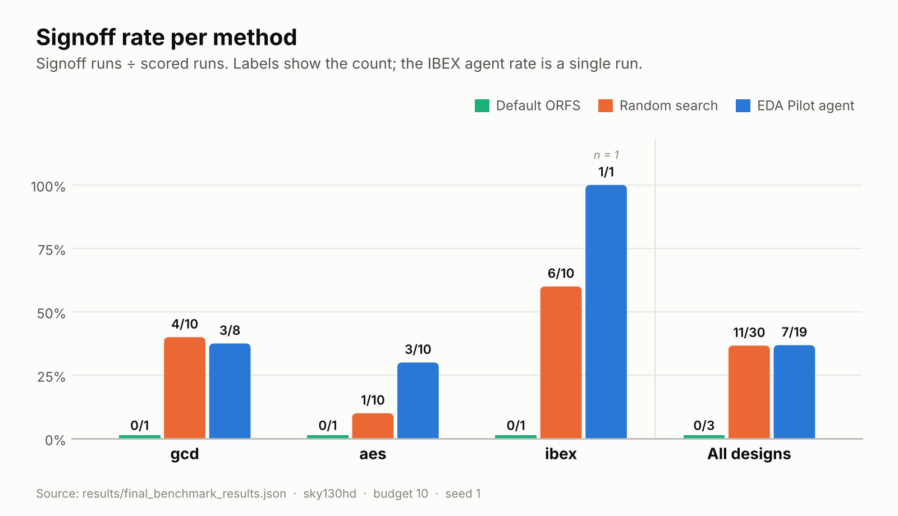</td>
    <td width="50%">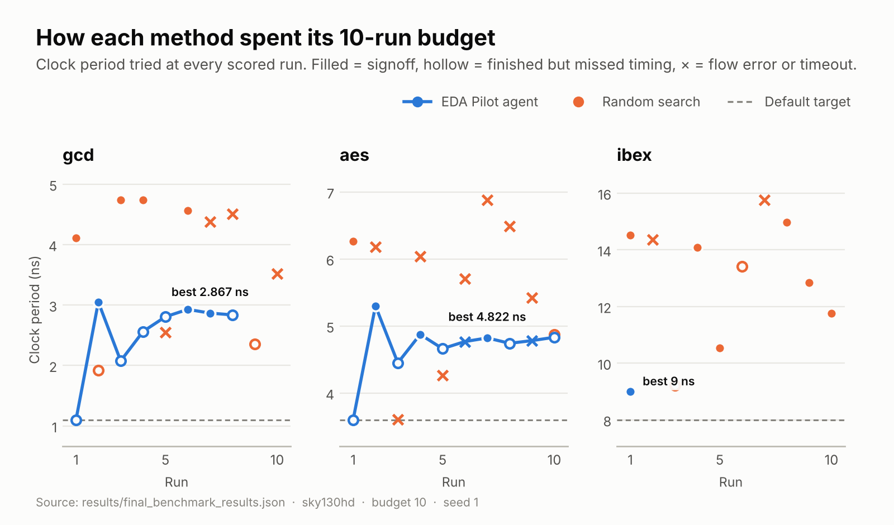</td>
  </tr>
  <tr>
    <td>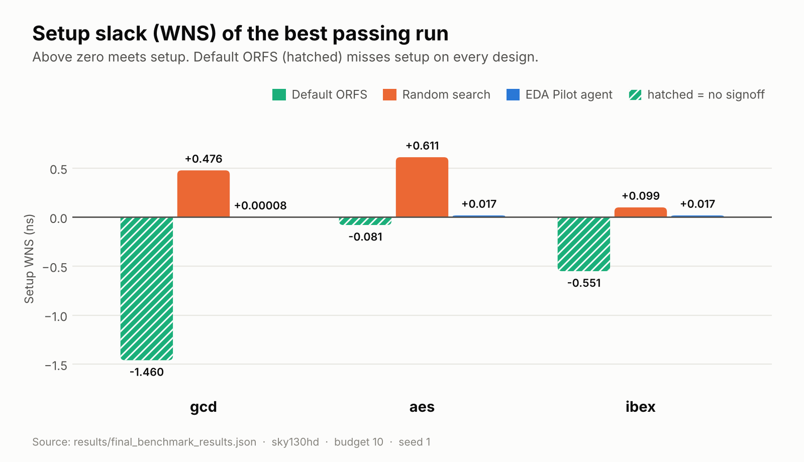</td>
    <td>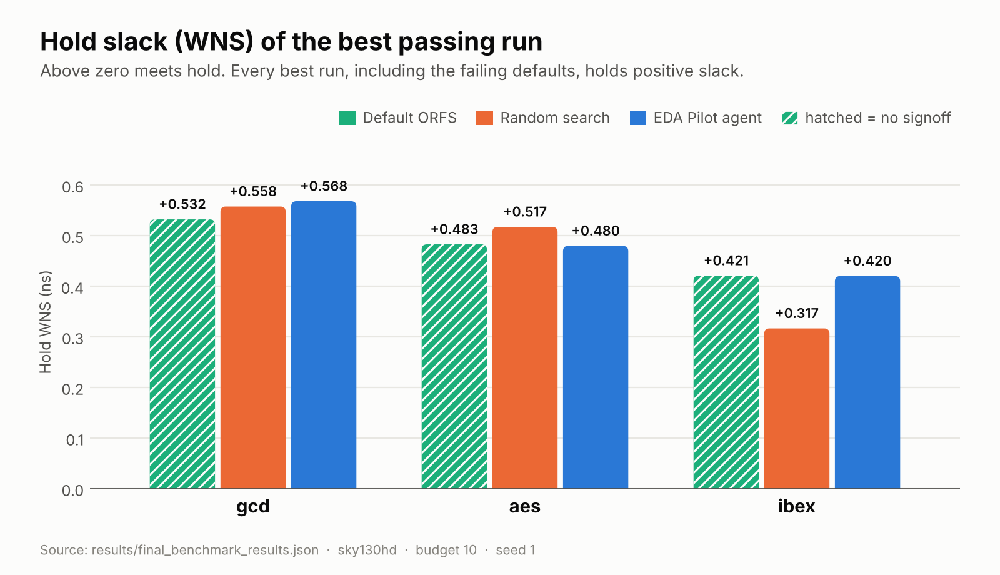</td>
  </tr>
  <tr>
    <td>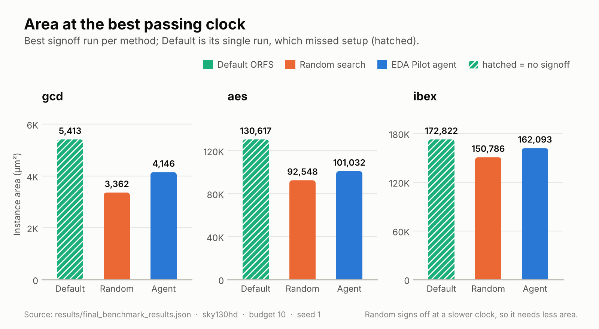</td>
    <td>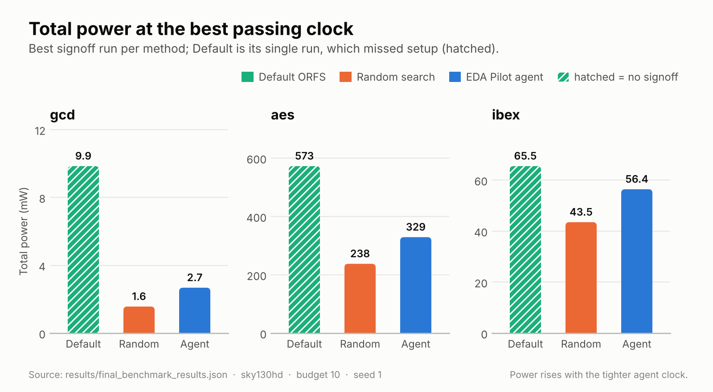</td>
  </tr>
  <tr>
    <td colspan="2" align="center">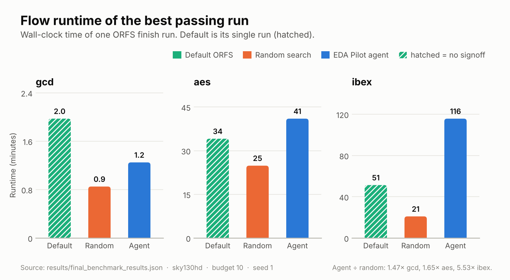</td>
  </tr>
</table>

## 🔍 Key findings

1. **Signoff vs default.** Default ORFS finished every design with DRC = 0 and still failed setup, by −1.460 ns (`gcd`), −0.081 ns (`aes`) and −0.551 ns (`ibex`). The agent signed off all three. Its passing clocks are *slower* than those default targets, so the gain over default is a legal signoff, not a faster clock.
2. **Clock vs random search.** The agent's best passing clock is 30.3%, 23.0% and 14.5% tighter than random search's best.
3. **The price of a tighter clock.** At their best passing points random search uses less area (−7% to −19%), less power (−23% to −41%) and less runtime. A PPA-weighted score would rank the methods differently.
4. **Signoff rate.** The agent's rate is clearly higher on `aes` (3/10 vs 1/10). It is about equal pooled (36.8% vs 36.7%) and slightly lower on `gcd`. The `ibex` 1/1 is a single run, not a rate.
5. **Failure modes differ.** Random search failed on placement density (FLW-0024), detailed placement (DPL-0033) and `aes` routing congestion (GRT-0116). The agent never hit a flow error. It missed timing near the boundary, and two `aes` runs hit the flow timeout.
6. **Search shape matters more than "intelligence".** The measured agent used the deterministic offline advisor, a guarded bisection on `_SDC_CLK_PERIOD`. That is the result the evidence supports. An LLM advisor plugs into the same two nodes and has not been benchmarked yet.

## 🖼️ Screenshots

<table>
  <tr>
    <td width="50%">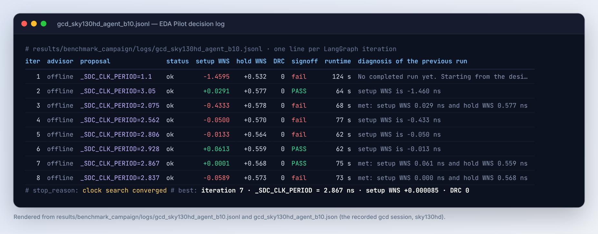<br><sub>The gcd agent session from its recorded decision log: 8 runs, converged at 2.867 ns.</sub></td>
    <td width="50%">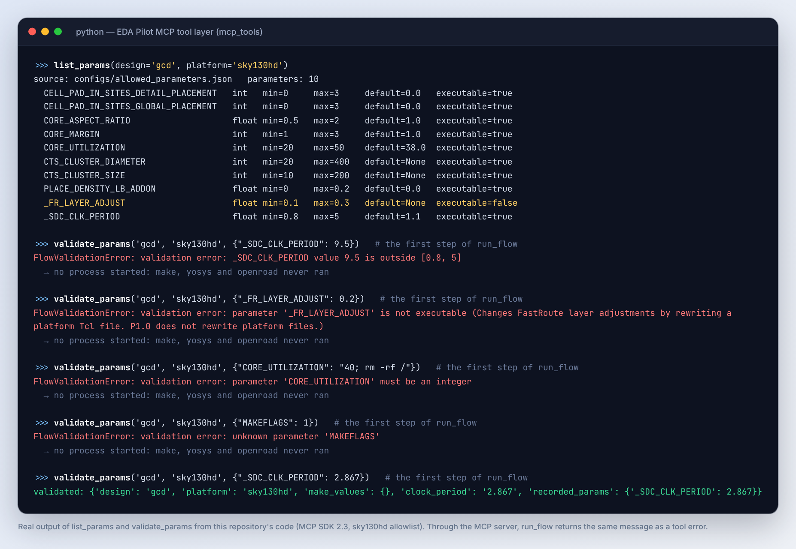<br><sub><code>list_params</code> and the validation that <code>run_flow</code> applies before <code>make</code> starts.</sub></td>
  </tr>
  <tr>
    <td>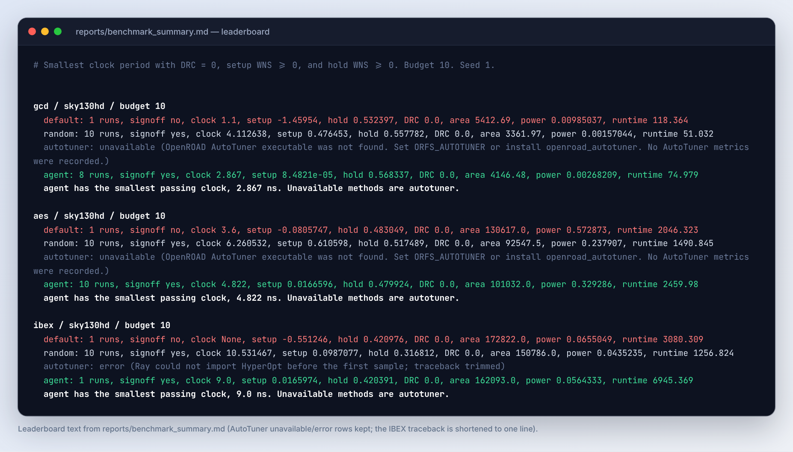<br><sub>Leaderboard text from <code>reports/benchmark_summary.md</code>.</sub></td>
    <td>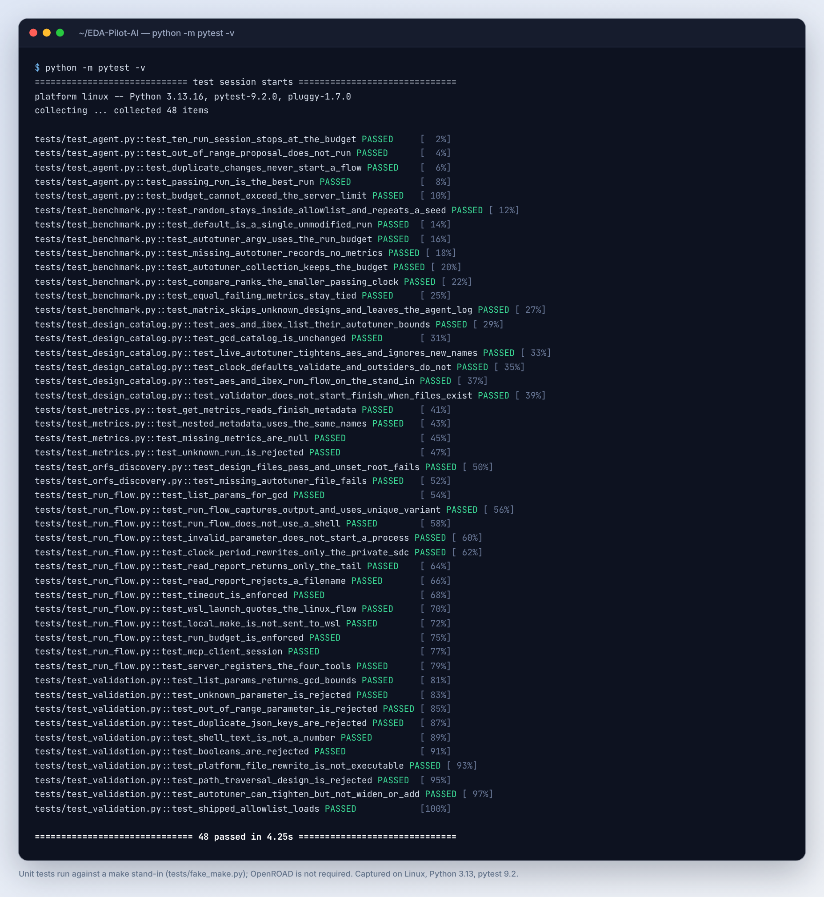<br><sub>48 unit tests against a <code>make</code> stand-in, with no OpenROAD needed.</sub></td>
  </tr>
</table>

## 🗂️ Repository layout

```text
EDA-Pilot-AI/
├── eda_pilot/            MCP server (eda-pilot-orfs) and settings
├── mcp_tools/            validation · run_flow (+ WSL bridge) · metrics · reports
├── agent/                LangGraph loop, state, Pydantic proposal models
├── benchmarks/           default · random · AutoTuner · agent harness + compare_results
├── configs/              allowed_parameters.json (sky130hd gcd / aes / ibex)
├── tests/                48 pytest tests with a make stand-in
├── scripts/              environment probes, ORFS discovery, campaign resume, release plots
├── tools/                Windows launcher for the AutoTuner installed in WSL
├── results/              final_benchmark_results.json, campaign checkpoints, decision logs
├── reports/              final benchmark report, summary, validation reports
├── plots/                release figures (regenerated from results JSON)
├── diagrams/             architecture (.svg / .mmd / .drawio), technology stack
├── docs/                 executive summary, stack, lessons, roadmap, interview guide
├── release/              v1.0 release notes, recruiter and hiring-manager summaries
├── assets/               logos, banner, screenshots
└── .github/              CI (pytest on Python 3.11–3.13), issue and PR templates
```

## 📚 Documentation

| Document | For |
| --- | --- |
| [PROJECT_OVERVIEW.md](PROJECT_OVERVIEW.md) | One-page overview |
| [ARCHITECTURE.md](ARCHITECTURE.md) | Components, data flow, safety model, design decisions |
| [BENCHMARK_RESULTS.md](BENCHMARK_RESULTS.md) | Methodology, every table, failure analysis, limitations |
| [CASE_STUDY.md](CASE_STUDY.md) | Problem → design → experiment → results → lessons |
| [docs/executive_summary.md](docs/executive_summary.md) | Two-minute read |
| [docs/technology_stack.md](docs/technology_stack.md) | Tools and versions |
| [docs/lessons_learned.md](docs/lessons_learned.md) | What the campaign taught |
| [docs/roadmap.md](docs/roadmap.md) | What comes next |
| [docs/interview_guide.md](docs/interview_guide.md) | Questions and model answers |
| [release/RELEASE_NOTES_v1.0.md](release/RELEASE_NOTES_v1.0.md) | v1.0 release notes |

## 🛣️ Roadmap

- **Now:** repair the AutoTuner environment (Ray + HyperOpt) and run it at the same budget and seed. Record failures as failures.
- **Next:** repeat random search and the agent over more seeds, and publish the distribution of best passing clocks.
- **Then:** benchmark an LLM advisor in `analyse` / `propose` against the offline bisection on the same allowlist.
- **Later:** a PPA-ranked view of the same trials, wider clock floors for `ibex`, a second PDK (nangate45) and larger sky130hd designs.

Details: [docs/roadmap.md](docs/roadmap.md).

## 📖 Citation

If this project is useful in your work, please cite it and the tools it builds on ([citations.bib](citations.bib)):

```bibtex
@software{raghavan_eda_pilot_ai_2026,
  author  = {Raghavan, Nilesh P},
  title   = {{EDA Pilot AI}: A Guarded LangGraph and MCP Agent for Timing Closure in OpenROAD},
  year    = {2026},
  version = {1.0.0},
  url     = {https://github.com/NileshModlier/EDA-Pilot-AI}
}
```

## 🤝 Contributing

Issues and pull requests are welcome. Please read [CONTRIBUTING.md](CONTRIBUTING.md) and the [Code of Conduct](CODE_OF_CONDUCT.md) first. The one rule that is never relaxed: **new knobs enter through `configs/allowed_parameters.json`, never through a prompt.**

## 📄 License

Released under the [MIT License](LICENSE). OpenROAD, OpenROAD Flow Scripts, Yosys, KLayout and the SkyWater SKY130 PDK are separate projects under their own licenses.

<sub>Built on <a href="https://github.com/The-OpenROAD-Project/OpenROAD">OpenROAD</a>, <a href="https://github.com/The-OpenROAD-Project/OpenROAD-flow-scripts">OpenROAD Flow Scripts</a>, <a href="https://github.com/YosysHQ/yosys">Yosys</a>, <a href="https://www.klayout.de/">KLayout</a>, the <a href="https://github.com/google/skywater-pdk">SkyWater SKY130 PDK</a>, <a href="https://github.com/langchain-ai/langgraph">LangGraph</a> and the <a href="https://modelcontextprotocol.io/">Model Context Protocol</a>.</sub>
