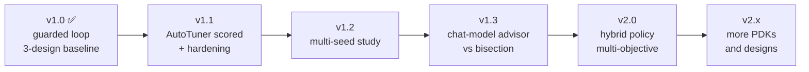

# Roadmap

The v1.0.0 baseline is closed. Later work starts from `results/final_benchmark_results.json` and **adds** trials. It never replaces the existing ones. Each milestone below says what it would prove and how it would be measured.

## v1.1 — Complete the comparison and harden the campaign

**Goal:** every method in the harness has scored results, and the known operational gaps are closed.

- [ ] Repair the AutoTuner environment so Ray imports HyperOpt. Confirm `openroad_autotuner --help` from the same entry point the harness uses.
- [ ] Run AutoTuner on `gcd`, `aes` and `ibex` at budget 10, seed 1. A failure is recorded as a failure, and the existing rows are left unchanged.
- [ ] Write the ORFS error line (for example FLW-0024) into the trial record when `make` exits non-zero.
- [ ] Treat a dead parent process as an unscored attempt, even when the manifest still says `running`.
- [ ] Checkpoint the agent's clock bounds after every iteration, not only at session end.
- [ ] Clamp the offline advisor's minimum step to the current bracket `[clock_low, clock_high]`. This addresses the wasted final `aes` run.
- [ ] Replace hardcoded `/home/administrator` and `\\wsl$\Ubuntu` paths in helper scripts with settings.

**Done when:** the leaderboard has four populated methods per design, and a killed campaign can resume without replaying flows.

## v1.2 — Test whether the clock gains hold

**Goal:** turn the single-seed 14.5–30.3% result into a distribution.

- [ ] Repeat random search and the agent at five or more seeds on the same designs and allowlist.
- [ ] Report the median and spread of the best passing clock, and the signoff rate with its denominator.
- [ ] Keep the 0.05 ns early-stop rule, and publish runs used per session.
- [ ] Widen the `ibex` clock floor below 9.0 ns, justified from the design rather than the autotuner sweep, to find where the real limit is.

**Done when:** the README headline is stated as a range across seeds, not a single number.

## v1.3 — Benchmark the chat-model advisor

**Goal:** measure whether diagnosis from metrics and report tails beats the bisection baseline.

- [ ] Run `EDA_PILOT_MODEL` sessions on all designs with the same budget and seeds as v1.2.
- [ ] Record model name, prompt version, token usage and every proposal reason in the decision log.
- [ ] Compare: best passing clock, runs-to-convergence, signoff rate, and rejected-proposal rate (how often validation had to stop the model).
- [ ] Keep the boundary: the model stays on `analyse` and `propose`, and `validate`, `run` and `check` remain code.

**Done when:** the result says, with numbers, whether a model helps, hurts or ties.

## v2.0 — Hybrid policy and multi-objective reporting

**Goal:** keep the agent's clock win and recover random search's area and power.

- [ ] Phase 1: bisect the clock. Phase 2: spend the remaining budget on utilization, density and CTS knobs at the found clock.
- [ ] Publish a second ranking by area and by power among signoff points, alongside the clock-first leaderboard.
- [ ] Budget by wall-clock hours as well as run count, since one `ibex` run costs about a hundred `gcd` runs.
- [ ] Use report tails (congestion and DRC) to choose feasibility knobs before a run fails.

**Done when:** a single method matches the agent's clock while closing the area and power gap to random search.

## v2.x — Broaden the flow, one platform at a time

- [ ] A second PDK, such as `nangate45`, through the same tighten-only allowlist.
- [ ] A larger sky130hd design.
- [ ] Each addition needs `config.mk`, `constraint.sdc` and `autotuner.json`, and the allowlist must still refuse names and ranges that a design file tries to widen.
- [ ] Linux-native execution path documented and tested alongside the WSL bridge.

## Explicitly out of scope until the measurements above exist

DRC prediction, reinforcement learning and GNN-based slack prediction were excluded from this project. They stay excluded until AutoTuner has scores and the clock result has been repeated across seeds.

## How to contribute to the roadmap

Pick an unchecked item, open an issue that states the measurement you will add, and follow [CONTRIBUTING.md](../CONTRIBUTING.md). Results PRs must add to the record, never edit existing trials.
