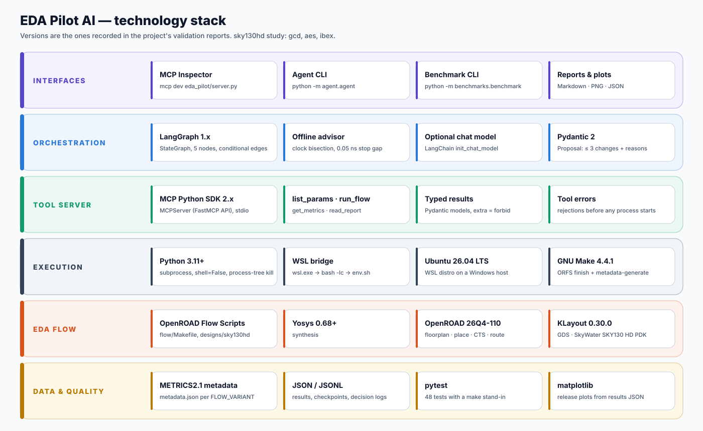

# Technology stack

<p align="center"></p>

## At a glance

| Layer | Technology | Version | Role in EDA Pilot AI |
| --- | --- | --- | --- |
| Agent orchestration | **LangGraph** | `>=1,<2` | Five-node `StateGraph` with conditional edges, retry routing and a typed state |
| Optional model access | **LangChain** (`init_chat_model`, `langchain_core.messages`) | optional | Chat-model advisor for `analyse` and `propose` when `EDA_PILOT_MODEL` is set. Not installed by default |
| Tool protocol | **Model Context Protocol**, MCP Python SDK 2.x (`MCPServer`) | `>=2,<3` | `eda-pilot-orfs` server over stdio with four typed tools |
| Data contracts | **Pydantic v2** | `>=2,<3` | `Proposal`, `ParameterChange`, `Diagnosis`, `RunResult`, `MetricsResult`, `ParameterList`, `ReportResult`, with `extra="forbid"` on agent inputs |
| Language | **Python** | ≥ 3.11 (3.11 on the benchmark host) | Server, guardrails, agent and harness. The standard library covers `subprocess`, `random`, `json`, file locking and `argparse` |
| Testing | **pytest** | `>=8` | 48 tests with a `make` stand-in (`tests/fake_make.py`), so no OpenROAD install is needed |
| Synthesis | **Yosys** | 0.68+ | RTL → gate-level netlist (sky130hd cells) |
| Physical design | **OpenROAD** | `26Q4-110-g91e5f5ff2f` | Floorplan, placement, CTS, global and detailed routing, STA, power |
| GDS | **KLayout** | 0.30.0 | Final GDS stream-out (`6_final.gds`) |
| Flow driver | **OpenROAD Flow Scripts** + **GNU Make** | Make 4.4.1 | `make finish`, then `make metadata-generate`, with a unique `FLOW_VARIANT` per run |
| Metrics | **METRICS2.1** `metadata.json` | | Setup/hold WNS and TNS, power, area, utilization, DRC count |
| PDK | **SkyWater SKY130**, `sky130hd` | | High-density standard cells |
| Designs | `gcd`, `aes`, `ibex` | ORFS bundled | Small arithmetic block, AES cipher core, Ibex RISC-V core |
| Host OS | **Windows + WSL**, Ubuntu 26.04 LTS | | ORFS runs inside WSL. The tool layer bridges with `wsl.exe -d <distro> -- bash -lc` |
| Baseline optimizer | **OpenROAD AutoTuner** (Ray Tune + HyperOpt) | separate Python 3.12 env | Scheduled as a comparison method. It produced no scored trials |
| Analysis and plots | **matplotlib** | | `scripts/make_release_plots.py` redraws all figures from the results JSON |

## Why these choices

**LangGraph over a hand-rolled loop.** The control flow has real branches: validation retries, a reject-after-three path, and two different stop conditions. A declarative graph makes those edges explicit, testable and printable. The state is a typed dictionary, so every node's inputs and outputs are visible in the decision log.

**MCP over a bespoke RPC.** The tool layer is the one place a proposal becomes a process. Publishing it over MCP means MCP Inspector, IDE assistants and other agents get the same validation and budget guarantees as the built-in agent, with no additional code.

**Pydantic for every boundary.** A model's output is untrusted input. `extra="forbid"`, length limits (≤ 3 changes, reasons ≤ 500 characters) and numeric types reject malformed proposals before the allowlist even runs.

**`subprocess` with `shell=False`, never a shell string.** The argv is built from fixed templates and regex-checked tokens. The WSL bridge is the only place a bash script is assembled, and it uses only tokens that already passed those checks.

**WSL rather than a native Windows port.** OpenROAD and ORFS are supported on Linux. Running them inside WSL keeps the tools unmodified while the Python side runs on the Windows host.

**METRICS2.1 instead of report scraping.** `metadata.json` is the flow's own structured record. Reports are used only as capped text tails for diagnosis, never as a metric source.

## Installing the Python side

```bash
python -m venv .venv && source .venv/bin/activate      # Windows: .venv\Scripts\activate
pip install -e ".[dev]"                                 # mcp, pydantic, langgraph, pytest
pytest                                                  # 48 tests, no OpenROAD needed
pip install langchain langchain-openai                  # optional: chat-model advisor
```

The EDA toolchain itself (Yosys, OpenROAD, KLayout and ORFS) follows the upstream [OpenROAD-flow-scripts](https://github.com/The-OpenROAD-Project/OpenROAD-flow-scripts) build instructions. Project notes are in [`docs/openroad_build.md`](openroad_build.md) and [`docs/orfs_environment.md`](orfs_environment.md).

## Versions observed during release verification

The release's test suite was re-run in clean Linux environments on Python 3.11, 3.12 and 3.13 (with `mcp` 2.3.0, `langgraph` 1.2.18, `pydantic` 2.14.1 and `pytest` 9.2.0 on 3.13): **48 passed** on each. This confirms the code, not the EDA results. The benchmark itself ran on the host and toolchain listed above.
